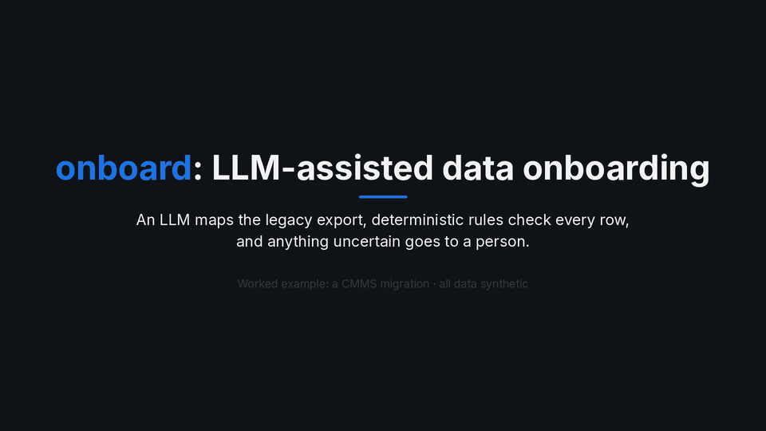
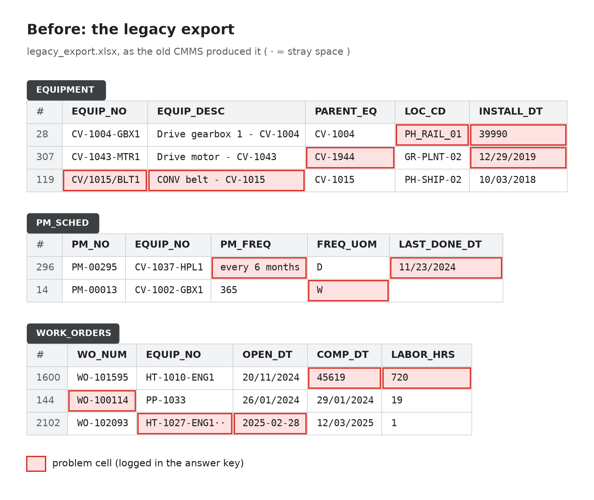
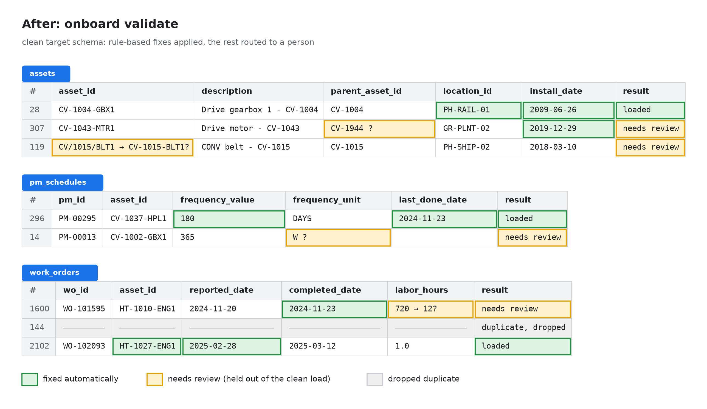
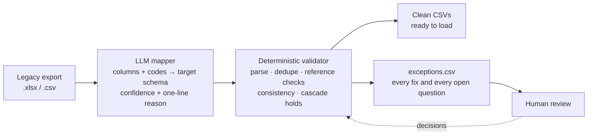
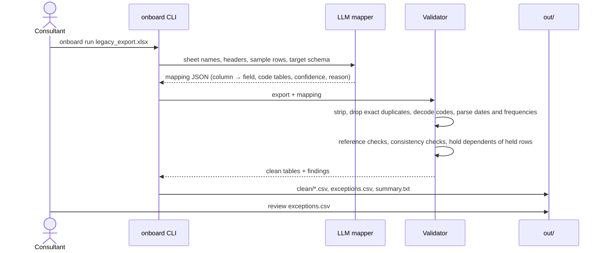

# onboard

**LLM-assisted data onboarding for enterprise systems.**



<sub>28-second highlights. Full walkthrough (77 s, 1080p MP4): [demo.mp4](https://github.com/Huw01/onboard/releases/download/v0.1.0/demo.mp4), attached to the [v0.1.0 release](https://github.com/Huw01/onboard/releases/tag/v0.1.0). The terminal part is a real `onboard run` replaying the recorded responses in `tests/fixtures/llm/`; every number comes from [`docs/eval.md`](docs/eval.md). Rebuild with `python scripts/make_demo_video.py` (needs ffmpeg and the raw computer-use recording, which is not in the repo).</sub>

## What it does

Every enterprise system go-live starts with someone else's data. The customer hands over a legacy export with cryptic column names, codes nobody has documented, duplicates, broken hierarchies, mixed date formats and free text where numbers should be. `onboard` turns that into a clean import file using the pattern that safe enterprise migrations follow:

1. **Legacy export in.** The worked example is a CMMS/EAM export (locations, assets, PM schedules, work orders) for a synthetic mine and port terminal.
2. **The LLM proposes the mapping.** Which legacy column is which target field, and what each legacy code means, each with a confidence and a one-line reason. It proposes; it does not load anything.
3. **Deterministic validation guards every value.** Plain code parses, normalises and cross-checks every row. A value is fixed only by a rule that can't be wrong for it.
4. **Anything uncertain goes to a human-review queue.** Unclear codes, orphan records, dates that read two ways and suspicious quantities are held with the reason, never guessed. The LLM can help answer those questions, but its answers go back through the same validator.
5. **Clean import file plus an audit trail.** Clean CSVs ready to load, and next to them every fix, every held row with its reason, every mapping decision and every LLM answer with its confidence and cost.

The principle: **the AI never silently changes data.** Every loaded value is either untouched, fixed by a certain rule, or decided by a person, and you can see which. That is how migrations are done safely at enterprise clients: automation does the volume, deterministic checks keep it honest, and people make the judgement calls, with a record of all of it.

<!-- KEY:START -->
**37 / 37** legacy columns mapped correctly by the LLM · **0** correct cells changed by the LLM in the recorded run (1 cell across 3 live reruns) · **$0.58–0.77** per full run
<!-- KEY:END -->

How these are measured, the full breakdown per corruption type and the rules-only baseline: [`docs/eval.md`](docs/eval.md).
On a held-out export with renamed columns and unseen corruption types, the live mapping call did not complete; no file was written ([details](docs/eval.md#held-out)).





<sub>Green: fixed by a rule that can't be wrong for that value. Amber: held out of the clean load for a person to decide. Grey: exact duplicate, dropped. Side-by-side version: [`docs/img/before_after.png`](docs/img/before_after.png). Regenerate with `python scripts/render_before_after.py`.</sub>

## How it works



The split is deliberate. The model only decides fuzzy things: column meaning, code meaning, and later ambiguous records. Plain code checks every row, and anything it can't fix with certainty is routed to a person instead of guessed.

| Action | Meaning | Examples |
|---|---|---|
| `fixed` | unambiguous rule, row is loaded | stray whitespace, ISO or Excel-serial dates, `12/29/2019` (only valid as MM/DD), `every 6 months` → 180 days, `PH_RAIL_01` → `PH-RAIL-01` |
| `dropped` | exact duplicate row | the same work order exported twice |
| `review` | a person decides, row is held | blank required field, orphan parent, `CV/1015/BLT1` vs `CV-1015-BLT1`, unit code `W`, `720` labor hours (minutes?) |
| `held` | row is fine but depends on a held row | PMs and work orders of an asset under review |
| `warning` | column-level caveat | a date column mixes DD/MM and MM/DD, so values valid either way round can't be verified |

### One run



`onboard run legacy_export.xlsx` does the whole pipeline: the LLM proposes the mapping (written to `out/mapping.json`, same format as [`mappings/legacy_cmms.json`](mappings/legacy_cmms.json)), anything it is unsure of goes to `out/mapping_questions.csv`, the validator runs, and an optional LLM pass (`--review/--no-review`) answers closed questions the rules can't settle (ambiguous day/month dates, labor that looks like minutes, near-duplicates). Accepted answers are re-validated from scratch, so nothing the LLM says skips a check. Once a person has confirmed the mapping, pass it back with `--mapping` to skip the proposal. `onboard validate` still runs the rules alone with a given mapping.

## From computer-use prototype to API

The first version of this workflow was a computer-use agent working the spreadsheet the way a person would. The video's "Option A" is a real recording of that approach: a computer-use agent on a desktop, asked to fix **6 cells** of `legacy_export.xlsx` by hand in LibreOffice Calc. It took about **50 s and ~30 actions**. Calc's Name Box autocomplete swallowed keystrokes, so cell values went into the Name Box and a sheet reference went into a cell. It saved the file with those wrong values in it, and then Calc froze. **1 of the 6 edits was correct.**

That is not a criticism of the agent. Driving a GUI cell by cell is the wrong interface for this job: every action is a chance to land in the wrong place, nothing checks the result, and it doesn't scale past a handful of cells. The direct-API version makes **one structured mapping call** for the whole export, runs the deterministic validator over all **7.9K rows**, and asks the LLM only closed questions about the rows the rules can't settle (8 calls in total, $0.77). Every LLM answer is re-validated, and the run is scored against an answer key.

Watch both side by side in the [demo video](https://github.com/Huw01/onboard/releases/download/v0.1.0/demo.mp4) (or the GIF at the top).

## Quickstart

```bash
python -m venv .venv && source .venv/bin/activate
pip install -e ".[dev]"
onboard generate                      # clean target-schema dataset -> data/clean
onboard corrupt                       # legacy export + answer key -> data/legacy, data/ground_truth
onboard validate --as-of 2026-09-30 --truth data/ground_truth   # rules only -> out/

# full pipeline (LLM mapper + validator + LLM review), no API key needed:
# replays the recorded grok-4.7 responses in tests/fixtures/llm/
onboard run data/legacy/legacy_export.xlsx --llm-mode replay --as-of 2026-09-30 --truth data/ground_truth

# live run: export XAI_API_KEY=... then drop --llm-mode replay (≈ $0.77, ≈ 11 min)
pytest
```

## Repository layout

| Path | What it is |
|---|---|
| `src/onboard/generate.py` | Seeded generator for the clean target schema (seed 42, byte-reproducible). |
| `src/onboard/corrupt.py` | Turns the clean data into a legacy export and logs every corruption. |
| `src/onboard/validate.py` | Deterministic validator: fixes, holds, exceptions, run summary. |
| `src/onboard/score.py` | Scores a run against the answer key. |
| `src/onboard/llm.py` | Thin xAI client: structured output, usage and $ logging, record/replay cache. |
| `src/onboard/mapper.py` | LLM mapper: profiles the export, proposes the mapping, applies only guarded answers. |
| `src/onboard/review.py` | LLM review pass: closed questions for rows the rules can't settle. |
| `src/onboard/pipeline.py`, `evals.py` | `onboard run` end to end, and its evaluation against the answer key. |
| `tests/fixtures/llm/` | Recorded LLM responses, replayed by pytest and CI (no key needed). |
| `mappings/legacy_cmms.json` | Reference source → target mapping (what the LLM mapper must reproduce). |
| `data/clean/` | Clean dataset: sites, locations, assets, PM schedules, work orders. |
| `data/legacy/legacy_export.xlsx` | The same data as a legacy CMMS export (sheets `LOCATIONS`, `EQUIPMENT`, `PM_SCHED`, `WORK_ORDERS`), plus one CSV per sheet. |
| `data/ground_truth/` | Answer key: clean tables, `corruptions.csv`, `row_map.csv`, `column_mapping.csv`. |
| `scripts/render_before_after.py` | Renders the images above (`pip install -e ".[docs]"`). |
| `scripts/eval_report.py` | Regenerates `docs/eval.md` and the README results from the recorded run. |
| `scripts/make_demo_video.py` | Builds the demo video and `docs/media/demo.gif`. |

## How this was built

This repo was pair-built with AI coding agents. The author set the design and the rules the code has to obey: the eval methodology (seeded clean data, a corruptor that logs every change into an answer key, scoring by outcome per corruption type, recorded LLM runs replayed in CI), and the guard policy (a deterministic validator that every value passes through, an LLM that can propose but never bypass it, and the zero-silent-corruption rule: a loaded value is either untouched or fixed by a rule that is certain, and everything else goes to a person). The corruption types come from hands-on CMMS migration work: Excel serial dates, mixed day/month formats, free-text PM frequencies, labor in minutes, broken asset hierarchies and near-duplicate work orders are what real legacy exports look like.

## Roadmap

- [x] Skeleton, CI
- [x] Clean dataset + corruptor with answer key
- [x] Deterministic validator
- [x] LLM mapper with structured output (`onboard run`)
- [x] Eval suite: mapping accuracy, recovery rate, tokens and $ per run
- [x] Demo GIF and video

The site (a fictional mine and port terminal) and all of its data are synthetic. MIT licensed.
