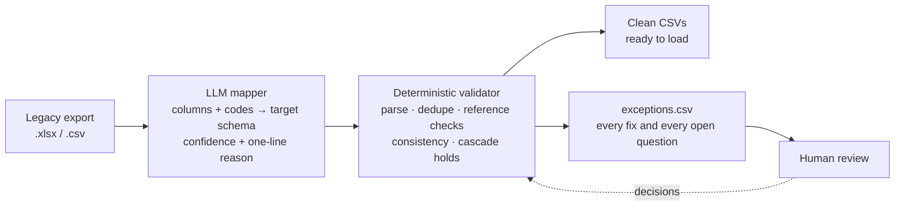
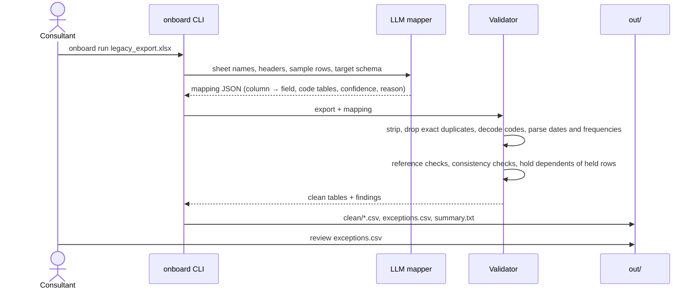

# onboard

**LLM-assisted data onboarding for enterprise systems.**

Every enterprise system go-live starts the same way. The customer hands over a legacy export with cryptic column names, duplicate records, broken hierarchies, mixed date formats and free-text values, and someone spends days mapping and cleaning it by hand. `onboard` lets an LLM make the fuzzy calls (which column is which, what a legacy code means), wraps every value in deterministic checks so nothing gets silently corrupted, routes the edge cases to a person, and proves the result with evals against a known answer key.

The worked example is a CMMS/EAM migration (assets, PM schedules, work orders) for a synthetic mine and port terminal.


<sub>Green: fixed by a rule that can't be wrong for that value. Amber: held out of the clean load for a person to decide. Grey: exact duplicate, dropped. Side-by-side version: [`docs/img/before_after.png`](docs/img/before_after.png). Regenerate with `python scripts/render_before_after.py`.</sub>

## How it works



The split is deliberate. The model only decides fuzzy things: column meaning, code meaning, and later ambiguous records. Plain code checks every row, and anything it can't fix with certainty is routed to a person instead of guessed.

| Action | Meaning | Examples |
|---|---|---|
| `fixed` | unambiguous rule, row is loaded | stray whitespace, ISO or Excel-serial dates, `12/29/2019` (only valid as MM/DD), `every 6 months` → 180 days, `PH_RAIL_01` → `PH-RAIL-01` |
| `dropped` | exact duplicate row | the same work order exported twice |
| `review` | a person decides, row is held | blank required field, orphan parent, `CV/1015/BLT1` vs `CV-1015-BLT1`, unit code `W`, `720` labor hours (minutes?) |
| `held` | row is fine but depends on a held row | PMs and work orders of an asset under review |
| `warning` | column-level caveat | a date column mixes DD/MM and MM/DD, so values valid either way round can't be verified |

### One run



`onboard run legacy_export.xlsx` does the whole pipeline: the LLM proposes the mapping (written to `out/mapping.json`, same format as [`mappings/legacy_cmms.json`](mappings/legacy_cmms.json)), anything it is unsure of goes to `out/mapping_questions.csv`, the validator runs, and an optional LLM pass (`--review/--no-review`) answers closed questions the rules can't settle (ambiguous day/month dates, labor that looks like minutes, near-duplicates). Accepted answers are re-validated from scratch, so nothing the LLM says skips a check. Once a person has confirmed the mapping, pass it back with `--mapping` to skip the proposal. `onboard validate` still runs the rules alone with a given mapping.

## Results so far (validator only, reference mapping)

The sample export has **2,097 injected corruptions**, every one logged in [`data/ground_truth/corruptions.csv`](data/ground_truth/corruptions.csv). Scored against that answer key (`onboard validate --as-of 2026-09-30 --truth data/ground_truth`):

| Metric | Result |
|---|---|
| Corruptions caught (fixed, dropped or held) | 1,991 / 2,097 (95.0%) |
| False positives (findings on untouched rows) | **0** |
| Cells fixed automatically | 1,665 |
| Rows loaded identical to ground truth | 7,136 / 7,893 (90.4%); the rest are held for review |
| Silent errors in the clean output | 106, all of them undetectable from the file alone (below) |

What can't be recovered, and how it's surfaced:

- **104 day/month swaps that are valid either way** (`08/09/2017`). Once a column is known to mix DD/MM and MM/DD, the validator raises a column-level `warning` with the count, but no rule can tell which reading is right. The fix belongs at the source: ask which entry screen or batch produced them.
- **2 labor values recorded in minutes that still look like plausible hours** (`30` for 0.5 h).

The tests pin this down: zero false positives, only these two kinds are ever missed, and the silent errors are exactly those cells.

## Eval results

<!-- EVAL:START -->
Generated by `scripts/eval_report.py` from the recorded run (`grok-4.7`, recorded 2026-10-11; replayed from `tests/fixtures/llm/`, so CI checks these numbers without an API key).

**Mapping** (LLM proposal after guards vs the hand-written [`mappings/legacy_cmms.json`](mappings/legacy_cmms.json))

| | correct |
|---|---|
| sheets → tables | 4 / 4 |
| columns → fields | 37 / 37 |
| code translations applied correctly | 32 / 35 |
| code translations left for a person | 3 |
| code translations applied wrongly | 0 |
| date format | yes |

**What happened to each of the 2,097 injected corruptions**: *fixed* = loaded with the right value, *removed* = duplicate kept out, *held* = routed to a person, *silent* = loaded with a wrong value.

Rules only:

| corruption type | injected | fixed | removed | held | silent |
|---|---|---|---|---|---|
| blank_required | 74 | 8 | 0 | 66 | 0 |
| date_excel_serial | 450 | 408 | 0 | 42 | 0 |
| date_iso | 380 | 336 | 0 | 44 | 0 |
| date_mmdd | 555 | 314 | 0 | 144 | 97 |
| exact_duplicate | 27 | 0 | 27 | 0 | 0 |
| free_text_frequency | 300 | 273 | 0 | 27 | 0 |
| location_casing | 20 | 19 | 0 | 1 | 0 |
| location_typo | 25 | 15 | 0 | 10 | 0 |
| near_duplicate | 36 | 0 | 0 | 36 | 0 |
| orphan_parent | 20 | 0 | 0 | 20 | 0 |
| orphan_reference | 12 | 0 | 0 | 12 | 0 |
| unit_mixup | 65 | 0 | 0 | 63 | 2 |
| whitespace | 133 | 119 | 0 | 14 | 0 |
| **TOTAL** | **2097** | **1492** | **27** | **479** | **99** |

Rules + LLM review pass (243 questions: 187 dates, 38 labor, 18 duplicates; 173 answers accepted at ≥ 0.85 confidence and re-validated):

| corruption type | injected | fixed | removed | held | silent |
|---|---|---|---|---|---|
| blank_required | 74 | 8 | 0 | 66 | 0 |
| date_excel_serial | 450 | 412 | 0 | 38 | 0 |
| date_iso | 380 | 340 | 0 | 40 | 0 |
| date_mmdd | 555 | 396 | 0 | 81 | 78 |
| exact_duplicate | 27 | 0 | 27 | 0 | 0 |
| free_text_frequency | 300 | 273 | 0 | 27 | 0 |
| location_casing | 20 | 19 | 0 | 1 | 0 |
| location_typo | 25 | 15 | 0 | 10 | 0 |
| near_duplicate | 36 | 0 | 36 | 0 | 0 |
| orphan_parent | 20 | 0 | 0 | 20 | 0 |
| orphan_reference | 12 | 0 | 0 | 12 | 0 |
| unit_mixup | 65 | 13 | 0 | 50 | 2 |
| whitespace | 133 | 121 | 0 | 12 | 0 |
| **TOTAL** | **2097** | **1597** | **63** | **357** | **80** |

| | rules only | + LLM review |
|---|---|---|
| silent errors in the load | 99 | 80 |
| correct cells changed by the LLM | – | 0 |
| false positives (clean rows held: all from codes left for a person) | 39 | 39 |
| rows loaded identical to ground truth | 6,884 / 7,893 | 6,976 / 7,893 |

**Cost per full run**: 8 calls, 60,413 input tokens (9,216 cached), 15,889 output + 95,062 reasoning tokens, **$0.77** (provider-reported), 1517 s of model time (review batches run in parallel).
<!-- EVAL:END -->

## From computer-use prototype to API

<!-- PLACEHOLDER: screenshots go in docs/img/computer-use/ (see the README there). -->

> **Placeholder, to be written.** The real-world version of this workflow was first prototyped with a computer-use agent driving the CMMS screens, then moved to direct API calls to cut tokens and run time. This section will show that progression with screenshots and before/after token and cost numbers.

<!--  -->
<!--  -->

## Quickstart

```bash
python -m venv .venv && source .venv/bin/activate
pip install -e ".[dev]"
onboard generate                      # clean target-schema dataset -> data/clean
onboard corrupt                       # legacy export + answer key -> data/legacy, data/ground_truth
onboard validate --as-of 2026-09-30 --truth data/ground_truth   # -> out/
pytest
```

## Repository layout

| Path | What it is |
|---|---|
| `src/onboard/generate.py` | Seeded generator for the clean target schema (seed 42, byte-reproducible). |
| `src/onboard/corrupt.py` | Turns the clean data into a legacy export and logs every corruption. |
| `src/onboard/validate.py` | Deterministic validator: fixes, holds, exceptions, run summary. |
| `src/onboard/score.py` | Scores a run against the answer key. |
| `mappings/legacy_cmms.json` | Reference source → target mapping (what the LLM mapper must reproduce). |
| `data/clean/` | Clean dataset: sites, locations, assets, PM schedules, work orders. |
| `data/legacy/legacy_export.xlsx` | The same data as a legacy CMMS export (sheets `LOCATIONS`, `EQUIPMENT`, `PM_SCHED`, `WORK_ORDERS`), plus one CSV per sheet. |
| `data/ground_truth/` | Answer key: clean tables, `corruptions.csv`, `row_map.csv`, `column_mapping.csv`. |
| `scripts/render_before_after.py` | Renders the images above (`pip install -e ".[docs]"`). |

## Roadmap

- [x] Skeleton, CI
- [x] Clean dataset + corruptor with answer key
- [x] Deterministic validator
- [x] LLM mapper with structured output (`onboard run`)
- [x] Eval suite: mapping accuracy, recovery rate, tokens and $ per run
- [ ] Demo GIF

The site (a fictional mine and port terminal) and all of its data are synthetic. MIT licensed.
